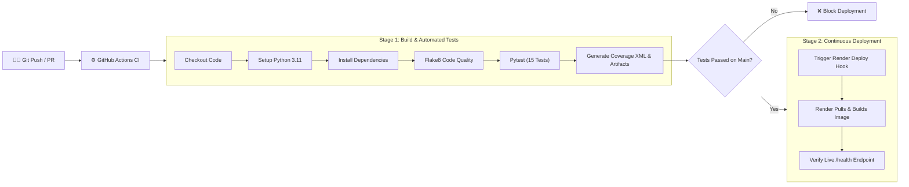

# ⚡ CloudPulse: Cloud Application with CI/CD Pipeline

[](https://github.com/your-username/cloud-app-cicd/actions/workflows/ci-cd.yml)
[](https://www.python.org/)
[](https://flask.palletsprojects.com/)
[](https://www.postgresql.org/)
[](https://render.com/)
[](LICENSE)

**CloudPulse** is a modern, responsive, cloud-native web application designed to track and observe cloud workloads, DevOps tasks, and system telemetry. It features an automated end-to-end **CI/CD pipeline powered by GitHub Actions** that handles automated dependency installation, linting, unit & integration testing, coverage reporting, and zero-downtime continuous deployment to **Render Cloud Platform**.

---

## 📑 Table of Contents

- [Architectural Overview](#-architectural-overview)
- [Key Features](#-key-features)
- [Tech Stack](#-tech-stack)
- [Directory Structure](#-directory-structure)
- [CI/CD Pipeline Workflow](#-cicd-pipeline-workflow)
- [Local Development & Setup](#-local-development--setup)
- [Running Automated Tests](#-running-automated-tests)
- [Cloud Deployment Guide (Render)](#-cloud-deployment-guide-render)
- [Monitoring & Health Endpoints](#-monitoring--health-endpoints)
- [REST API Reference](#-rest-api-reference)

---

## 🏛 Architectural Overview

CloudPulse is built following clean architectural separation of concerns:

```mermaid
flowchart TD
    User["👤 Browser Client / User"] -->|HTTPS / REST API| Cloud["☁️ Render Cloud Web Service"]
    
    subgraph AppContainer["Cloud Application (Flask + Gunicorn)"]
        WebRoutes["Web Interface (Jinja2 + HTML5/CSS3/JS)"]
        APIRoutes["REST API Endpoints (/api/tasks, /api/stats)"]
        HealthProbe["Observability Probes (/health, /api/metrics)"]
        DBManager["Unified Database Manager (Adapter Pattern)"]
        
        WebRoutes --> DBManager
        APIRoutes --> DBManager
        HealthProbe --> DBManager
    end

    Cloud --> AppContainer
    DBManager -->|DATABASE_URL (psycopg2)| CloudDB[("🐘 Cloud Managed PostgreSQL (Render/Neon)")]
    DBManager -.->|Fallback / Dev / Testing| LocalDB[("💾 SQLite Database")]
```

---

## 🌟 Key Features

1. **Responsive & Modern Frontend:**
   - Dark/Light mode theme toggle with persistent preferences.
   - Live search with debounce and real-time filtering by status and priority.
   - Clean card-based UI with progress indicators, status badges, and interactive modals.
   - Toast notification feedback system for asynchronous actions.

2. **Secure & Scalable Flask Backend:**
   - Clean Application Factory pattern (`create_app`).
   - Secure parameter-bound queries preventing SQL injection.
   - HTTP security headers (`Strict-Transport-Security`, `X-Content-Type-Options: nosniff`, `X-Frame-Options: DENY`, `X-XSS-Protection`).
   - Automatic format negotiation (clean JSON errors for API consumers, styled HTML error views for web users).

3. **Cloud Database with Dual-Engine Adapter:**
   - Automatic connection to **Cloud PostgreSQL** (Render, Neon, Supabase, AWS RDS) via `psycopg2` when `DATABASE_URL` is set.
   - Automatic zero-configuration fallback to **SQLite** for local development and in-memory test execution.
   - Automatic schema initialization and indexing (`idx_tasks_status`, `idx_tasks_priority`).

4. **Robust Automated Testing Suite:**
   - 15 comprehensive unit and integration tests covering API routes, models, health checks, error handlers, and database adapters.
   - Isolated in-memory database test fixtures via Pytest.

5. **Complete CI/CD Automation:**
   - Automated triggers on `push` and `pull_request` to `main` branch.
   - Flake8 syntax checks and code quality linting.
   - Pytest execution with coverage reporting and GitHub Actions artifact upload.
   - Automatic Continuous Deployment webhook triggering Render deployments upon passing tests.

6. **Cloud Observability & Health Probes:**
   - Standard `/health` endpoint reporting app uptime, version, database connectivity, and round-trip query latency.
   - `/api/metrics` providing aggregated task metrics and telemetry.

---

## 💻 Tech Stack

| Layer | Technologies |
|---|---|
| **Frontend** | HTML5, CSS3 Custom Properties (Variables), Vanilla JavaScript (ES6+), Inter / JetBrains Mono |
| **Backend** | Python 3.11, Flask 3.1, Gunicorn 21.2 |
| **Database** | Cloud PostgreSQL (psycopg2-binary) & SQLite3 (Built-in) |
| **Testing** | Pytest 9.x, Pytest-cov, TestClient |
| **CI/CD** | GitHub Actions (Ubuntu runner, Flake8, Artifacts) |
| **Cloud Hosting** | Render (Web Service + Managed PostgreSQL), Docker |

---

## 📂 Directory Structure

```
cloud-app-cicd/
├── .github/
│   └── workflows/
│       └── ci-cd.yml          # GitHub Actions CI/CD Pipeline definition
├── app/
│   ├── __init__.py            # Flask application factory, middleware, seed data
│   ├── config.py              # Environment configuration (Dev, Test, Prod)
│   ├── database.py            # Dual PostgreSQL & SQLite database adapter
│   ├── models.py              # Task and ActivityLog models with validation
│   ├── routes/
│   │   ├── __init__.py
│   │   ├── api.py             # REST API routes (/api/tasks, /api/stats, etc.)
│   │   ├── health.py          # /health & /api/metrics observability endpoints
│   │   └── web.py             # Frontend dashboard view route
│   ├── static/
│   │   ├── css/
│   │   │   └── style.css      # Design system, themes, animations, badges
│   │   └── js/
│   │       └── app.js         # Async REST client, DOM manipulation, toasts
│   └── templates/
│       ├── base.html          # Main HTML layout, navigation, and modal structure
│       ├── index.html         # Dashboard, metrics cards, task board, sidebar
│       ├── 404.html           # Custom 404 error page
│       └── 500.html           # Custom 500 error page
├── tests/
│   ├── __init__.py
│   ├── conftest.py            # Pytest fixtures and test client configuration
│   ├── test_api.py            # REST API unit & integration tests
│   ├── test_database.py       # Database manager and query tests
│   ├── test_health.py         # Health check and telemetry tests
│   └── test_web.py            # Web view rendering and error page tests
├── .env.example               # Environment variables template
├── .gitignore                 # Git ignore rules for Python, DBs, and IDEs
├── Dockerfile                 # Multi-stage lightweight production container
├── Procfile                   # Process command for PaaS platforms (Render/Heroku)
├── render.yaml                # Render Blueprint Infrastructure-as-Code
├── requirements.txt           # Python application dependencies
├── run.py                     # Application entry point
└── README.md                  # Comprehensive project documentation
```

---

## 🔄 CI/CD Pipeline Workflow

The CI/CD pipeline defined in `.github/workflows/ci-cd.yml` automates the release lifecycle:



---

## 🚀 Local Development & Setup

### Prerequisites
- Python 3.11+
- Git

### 1. Clone or Open the Repository
```bash
git clone https://github.com/your-username/cloud-app-cicd.git
cd cloud-app-cicd
```

### 2. Create and Activate a Virtual Environment
```bash
# On Windows (PowerShell)
python -m venv venv
.\venv\Scripts\Activate.ps1

# On Linux / macOS
python3 -m venv venv
source venv/bin/activate
```

### 3. Install Dependencies
```bash
pip install -r requirements.txt
```

### 4. Configure Environment Variables
Copy `.env.example` to `.env`:
```bash
cp .env.example .env
```
*(By default, leaving `DATABASE_URL` empty automatically uses local SQLite)*

### 5. Start the Application
```bash
python run.py
```
Open **[http://localhost:5000](http://localhost:5000)** in your browser.

---

## 🧪 Running Automated Tests

Run the full pytest suite with verbose output:
```bash
pytest tests/ -v
```

Run tests with test coverage reporting:
```bash
pytest tests/ -v --cov=app --cov-report=term-missing
```

---

## ☁️ Cloud Deployment Guide (Render)

### Option 1: Deploy with Render Blueprint (`render.yaml`)

1. Push this repository to GitHub.
2. Log in to [Render Dashboard](https://dashboard.render.com/).
3. Click **New +** -> **Blueprint**.
4. Connect your GitHub repository.
5. Render reads `render.yaml` and will automatically:
   - Provision a free managed **PostgreSQL** database (`cloudpulse-postgres`).
   - Provision a web service (`cloudpulse-web`) running Gunicorn.
   - Automatically inject the database connection string into the `DATABASE_URL` environment variable.
6. Click **Apply**. Your app will be live with an automatic HTTPS URL!

### Option 2: Automated Continuous Deployment via GitHub Actions

1. In your Render Dashboard, go to your Web Service -> **Settings** -> **Deploy Hook**.
2. Copy the Deploy Hook URL:
   `https://api.render.com/deploy/srv-xxxxxxxx?key=yyyyyyyy`
3. Go to your GitHub Repository -> **Settings** -> **Secrets and variables** -> **Actions**.
4. Click **New repository secret**:
   - Name: `RENDER_DEPLOY_HOOK_URL`
   - Value: `<Your Render Deploy Hook URL>`
5. *(Optional)* Add `APP_LIVE_URL`:
   - Name: `APP_LIVE_URL`
   - Value: `https://cloudpulse-web.onrender.com`
6. Now, whenever you push changes to `main`, GitHub Actions runs the entire test suite and triggers an automatic, zero-downtime deployment!

---

## 🩺 Monitoring & Health Endpoints

CloudPulse provides built-in endpoints for infrastructure monitoring, cloud load balancers, and external probes:

### 1. Application Health Check (`/health`)
- **Method:** `GET`
- **Status:** `200 OK` (when healthy), `503 Service Unavailable` (if database connectivity fails)
- **Sample Output:**
```json
{
  "status": "healthy",
  "timestamp": "2026-11-23T21:30:00.000000Z",
  "app": {
    "name": "CloudPulse",
    "version": "1.0.0",
    "environment": "production",
    "python_version": "3.11.9",
    "uptime_seconds": 124.5
  },
  "database": {
    "connected": true,
    "type": "PostgreSQL",
    "latency_ms": 1.2
  }
}
```

### 2. System Telemetry & Metrics (`/api/metrics`)
- **Method:** `GET`
- **Output:** Current memory status, total tasks, and completion rates.

---

## 📡 REST API Reference

| Method | Endpoint | Description | Request Body | Status Code |
|---|---|---|---|---|
| `GET` | `/health` | Cloud health check probe | None | `200` / `503` |
| `GET` | `/api/metrics` | System telemetry & task metrics | None | `200` |
| `GET` | `/api/tasks` | List tasks (supports `status`, `priority`, `search`) | None | `200` |
| `POST` | `/api/tasks` | Create a new task | JSON task payload | `201` / `400` |
| `GET` | `/api/tasks/<id>` | Retrieve a task by ID | None | `200` / `404` |
| `PUT` | `/api/tasks/<id>` | Full update of task | JSON task payload | `200` / `400` / `404` |
| `PATCH` | `/api/tasks/<id>` | Partial update of task fields | JSON fields | `200` / `400` / `404` |
| `DELETE` | `/api/tasks/<id>` | Delete task by ID | None | `200` / `404` |
| `GET` | `/api/stats` | Aggregated task counts & completion % | None | `200` |
| `GET` | `/api/activity` | Recent audit trail activity logs | None | `200` |
